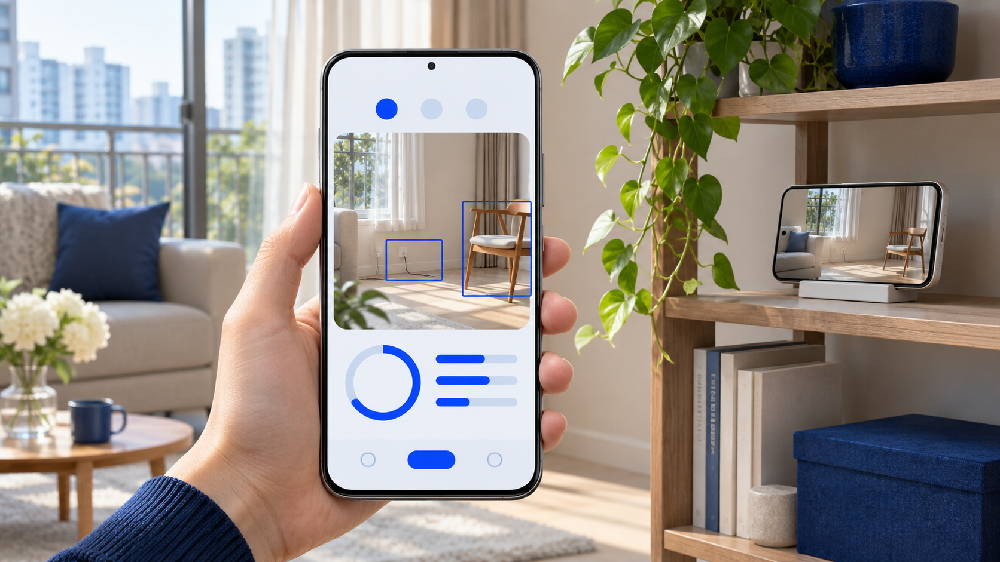

# 앗차차

### 집 안 구석구석, 하루하루 안심하게.

**놓치기 쉬운 위험은 사진으로 살피고, 궁금한 우리 집은 홈캠으로 확인하세요.**

[서비스 둘러보기](#앗차차가-하는-일) · [이용 방법](#이렇게-사용해요) · [기술 스택](#기술-스택)

서비스의 사용 장면을 표현한 콘셉트 이미지입니다.

 

## 우리 집의 평범한 순간을, 조금 더 안심되게

익숙한 공간에도 발에 걸릴 수 있는 전선과 이동에 방해가 되는 가구가 있습니다. 집을 비운 동안에는 안부가 궁금하기도 하고요.

**앗차차**는 사진 한 장으로 생활 속 위험 후보를 살펴보고, 사용하지 않는 휴대폰을 홈캠으로 활용할 수 있도록 돕는 생활안전 서비스입니다.

 

## 앗차차가 하는 일

### 사진으로 살피는 우리 집 안전

집 안을 촬영하면 AI가 사진 속 물건과 전기설비의 **위험 후보를 표시**하고, 선택한 대상과 공간에 맞는 참고 점수와 개선 권고를 보여줍니다.

- **어디를 살펴볼지 한눈에** — 사진 위 표시를 눌러 물건별 피드백을 확인해요.
- **상황에 맞는 개선 안내** — 가구·전선 등 발견된 항목에 맞춰 확인할 점을 알려드려요.
- **휴대폰에서 직접 분석** — 모델을 내려받은 뒤에는 PC와 인터넷 없이도 사진을 점검할 수 있어요.

### 남는 휴대폰으로 만드는 우리 집 홈캠

촬영용 공기계와 모니터링용 휴대폰을 연결하면, 떨어져 있어도 실시간 영상으로 집 안을 살펴볼 수 있습니다.

- **QR로 간편하게 등록** — 촬영용 기기의 QR을 모니터링 기기로 스캔해 연결해요.
- **서로 다른 장소에서도** — 두 기기를 같은 Tailscale 네트워크에 연결해 영상을 확인해요.
- **사람 위치 표시** — 모니터링 화면에서 사람의 움직임을 따라가는 박스를 볼 수 있어요.

 

## 이런 분께 도움이 돼요

| | |
| --- | --- |
| **부모님과 아이가 지내는 공간이 걱정될 때** | 가족의 생활환경을 사진으로 살피고, 직접 확인할 항목을 정리해요. |
| **익숙한 집을 다시 점검하고 싶을 때** | 전선이나 가구 주변처럼 놓치기 쉬운 곳을 한 번 더 확인해요. |
| **집을 비운 동안 공간이 궁금할 때** | 사용하지 않는 휴대폰을 활용해 멀리서도 집 안을 살펴봐요. |

 

## 이렇게 사용해요

### 사진 안전점검

1. 시작 화면에서 **사진 안전점검**을 선택해요.
2. 필요한 모델을 한 번 내려받아요.
3. 사진과 대상·공간을 선택해 점검해요.
4. 사진의 표시와 개선 권고를 확인해요.

### 홈캠

1. 두 휴대폰에서 **홈캠**을 선택해요.
2. 촬영용과 모니터링용 역할을 정해요.
3. QR로 등록하고 촬영을 시작해요.
4. 모니터링 휴대폰에서 영상을 확인해요.

> **이용 전 확인해 주세요** 
> 홈캠에는 두 기기의 Tailscale 연결이 필요하며, 촬영용 휴대폰은 앱과 화면을 켜 둔 상태여야 합니다. 사진점검 모델은 처음 사용할 때 인터넷으로 내려받습니다.

 

## 소중한 공간을 위한 선택

휴대폰에서 직접 사진을 분석하면 사진을 별도의 분석 서버로 보내지 않습니다. 홈캠은 영상 녹화 없이 실시간 화면을 확인하는 방식이며, 사람 위치 표시도 모니터링 기기에서 처리합니다.

PC 서버 분석을 선택할 수도 있습니다. 이 경우 사진이 PC 서버로 전송됩니다. 자세한 접근 설정과 주의사항은 [보안 안내](SECURITY.md)에서 확인해 주세요.

 

## 기술 스택

| 분야 | 사용 기술 |
| --- | --- |
| **모바일** | React Native · Expo · Android |
| **홈캠** | WebRTC · Tailscale |
| **이미지 분석** | YOLOv8n · Grounding DINO · ONNX Runtime |
| **웹 / 서버** | React · Vite · FastAPI · SQLite |

개발 환경과 실행 방법은 [개발 안내](docs/development.md), 앱 연결 방식은 [홈캠 안내](docs/standalone-homecam.md)를 참고해 주세요.

 

## 알아두세요

- 사진의 표시와 점수는 **직접 확인을 돕는 참고 정보**이며 안전 인증이나 사고 확률이 아닙니다. 탐지되지 않은 위험도 있을 수 있어요.
- 모바일 전기설비 탐지는 별도 모델을 내려받는 **시험 기능**입니다. 전선·콘센트·멀티탭·플러그를 놓치거나 다른 물건으로 분류할 수 있습니다.
- 전기 모델은 메모리 사용량이 커서 RAM 5GiB 미만 기기에서는 실행이 제한됩니다. 상세 조건은 [개발 안내](docs/development.md)를 확인하세요.
- 홈캠은 자동 낙상 감지·긴급 출동·영상 녹화·잠금 화면 촬영 기능을 제공하지 않습니다.

 

**앗차차** 
사진 한 장의 확인과 작은 화면 하나로, 더 세심한 일상을.

