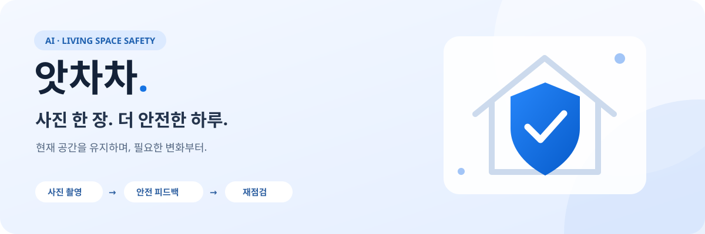
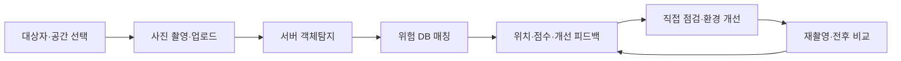
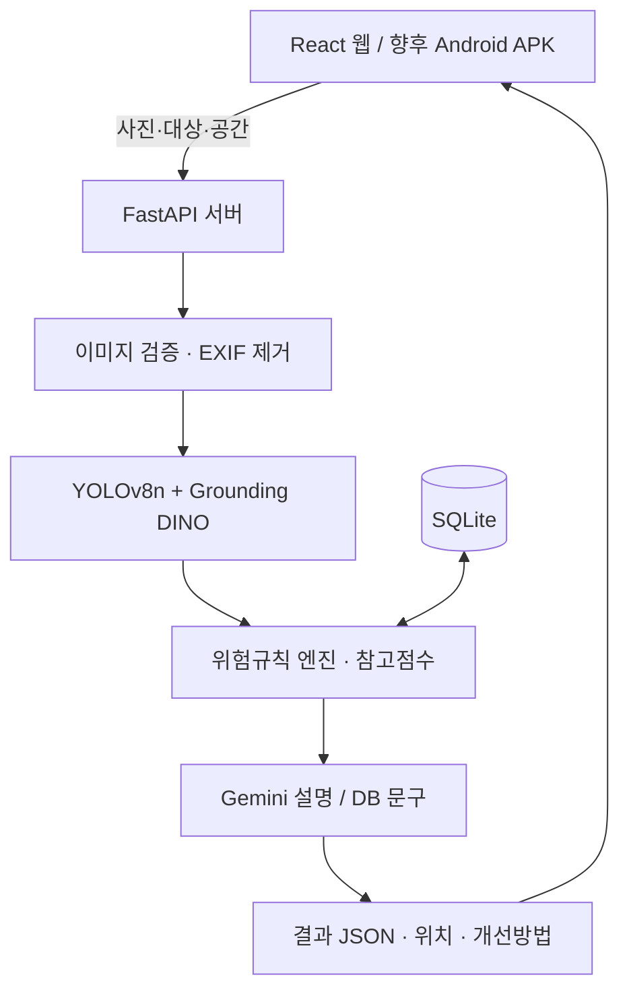

<div align="center">



### AI 기반 취약계층 생활안전 관리 서비스

**사진 촬영 → 사용자 맞춤 안전 피드백 → 정리·재배치·보완 → 재점검**


[프로젝트 소개](#프로젝트-소개) · [주요 기능](#주요-기능) · [빠른 시작](#빠른-시작) · [개발 계획](#개발-계획) · [보안](SECURITY.md)

</div>

---

## 프로젝트 소개

앗차차는 생활공간 사진에서 객체와 위치를 분석하고, **공간과 사용 대상자에 맞는 위험 확인 항목과 현실적인 개선방법**을 안내합니다. 새 가구를 사는 것보다 현재 환경을 유지하며 필요한 변화를 찾는 데 집중합니다.

> **정리 → 재배치 → 안전용품 보완 → 필요한 경우 교체** <br />
> 최소한의 비용과 변경으로 생활공간의 안전성을 높이는 것이 목표입니다.

| 점검 대상 | 생활공간 | 위험규칙 |
| :---: | :---: | :---: |
| 신생아 · 영유아 · 노약자 · 휠체어 사용자 · 거동 불편자 | 거실 · 침실 · 주방 · 욕실 · 현관 · 복도 · 계단 | **1,293개** 대상·공간·객체·조건 조합 |

현재 결과물은 **실제 객체탐지 API와 연결된 React 웹 MVP**입니다. 최종 목표는 **Android APK**이며, React Native·Expo 도입을 계획하고 있습니다. 모바일 프로젝트와 APK는 아직 생성하지 않았습니다.

> [!IMPORTANT]
> **이미지 분석·위험 판단·점수 계산·AI API 호출은 서버에서 수행합니다.** <br />
> 웹과 향후 앱은 촬영·업로드·결과 표시를 담당합니다. 모델 가중치, DB와 API 키를 APK에 넣지 않습니다.

## 서비스 흐름



사진을 올리고 위험 위치를 선택하면 해당 부분의 이유·예상 사고·개선방법을 볼 수 있습니다. 정리 후 재촬영하면 같은 대상과 공간의 이전 결과를 비교합니다. 예시 사진 체험도 실제 모델을 실행하며, 실제 분석 실패를 Mock 결과로 대체하지 않습니다.

## 주요 기능

| 기능 | 제공 내용 | 상태 |
| --- | --- | :---: |
| 사진 분석 | 촬영·업로드, 일반 객체 및 전선·콘센트·멀티탭 탐지 | ✅ 구현 |
| 맞춤 위험 판단 | 5개 대상·7개 공간과 DB 규칙 매칭 | ✅ 구현 |
| 위험 위치 | Bounding Box와 주의·위험 위치, 항목별 상세 피드백 | ✅ 구현 |
| 직접 점검 | 위험 있음 / 해당 조건 없음 / 미확인, 메모 저장 | ✅ 구현 |
| 개선 안내 | 정리·재배치·모서리 보호 몰딩 등 보완방법과 완료 체크 | ✅ 구현 |
| 참고 안전점수 | 감점·상한·점수 보류, 이전 기준 재계산 | ✅ 구현 |
| 이력·재점검 | 검색·대상자 필터·전후 비교·HTML/JSON 보고서 | ✅ 구현 |
| 인테리어 가이드 | 컨셉 4개, 컬러 예시, 가구 가상 배치 조절·저장 | ✅ 구현 |
| 웹 생활 확인 | 동의 기반 웹 활동·연결 상태, 보호자 읽기 링크 | ✅ 구현 |
| 위치 기록 | 권한·동의가 있고 화면이 표시 중일 때 약 1시간 간격 시도 | 🟡 조건부 |
| 실제 사진 AI 편집 | 서버 API 연결·동의·응답·오류 처리 | ⏸️ 비활성 |
| APK·백그라운드·푸시 | Android 앱, 화면 종료 후 관찰, 문자·푸시 | 📋 개발 예정 |

### 사용자별 확인 항목

- **신생아·영유아:** 부드러운 침구, 침대 주변 끈, 끼임, 작은 물건, 접근 가능한 콘센트 등을 확인합니다.
- **노약자:** 전선·장애물·단차·불안정한 의자·침대 주변 조명·이동 지지 환경을 확인합니다.
- **휠체어 사용자·거동 불편자:** 이동 장애물과 옮겨 앉을 때의 지지 환경 등을 확인합니다.

신생아·노약자 중심의 직접 점검 항목 12개를 추가했습니다. 가구 모서리는 **충격 흡수 몰딩·보호대**로 보완하도록 안내하며, 아기 침대 범퍼와 구분합니다. 규칙 수는 탐지 모델의 클래스 수나 정확도 지표가 아닙니다.

### 인테리어 가이드

**컨셉 선택 → 컬러 예시 → 가구 위치·회전 조절 → 서버에 배치 저장**

| 미니멀 화이트 | 내추럴 우드 | 소프트 모던 | 편안한 동선 |
| :---: | :---: | :---: | :---: |
| 밝은 중립색·정돈된 여백 | 우드·베이지·자연색 | 차분한 색상·부드러운 포인트 | 대비·이동 공간 중심 |

배치도는 사진에서 탐지한 가구를 활용한 **가상 예시**입니다. 초기 위치·크기·동선 선은 실측 결과가 아니며, 겹침·경계 경고도 가상 배치도 기준입니다. 실제 통로 폭이나 휠체어 통과 가능성을 계산하지 않습니다.

실제 사진 편집은 유료 호출 금지에 따라 `INTERIOR_IMAGE_ENABLED=false`로 유지합니다. 현재 컬러 예시는 **AI가 원본 사진을 편집한 이미지가 아닙니다.** 배치 저장과 완료 체크만으로 안전점수를 올리지 않습니다.

## 시스템 구성



| 구분 | 기술 | 역할 |
| --- | --- | --- |
| 웹 | React · Vite | 촬영·업로드·피드백·가이드·기록 UI |
| 서버 | Python · FastAPI · Uvicorn | 이미지 처리·위험 판단·점수·REST API |
| 일반 객체 | YOLOv8n ONNX · OpenCV DNN | COCO 80종 객체 탐지 |
| 전기설비 | Grounding DINO tiny ONNX | 전선·콘센트·멀티탭, 작은 콘센트 확대 재검증 |
| 설명 | Gemini API | DB 결과 기반 설명, 설정 모델 `gemini-3.1-flash-lite` |
| 저장소 | SQLite · 로컬 파일 | 점검·규칙·배치·선택 저장 사진 |
| 보조 확인 | HOG + 경량 선형 분류기 | 기존 전기설비 결과의 종류 불확실성 확인 |
| 모바일 계획 | React Native · Expo | 기존 API를 재사용하는 Android APK |

객체탐지 AI는 무엇이 어디에 있는지를, DB 규칙은 위험등급과 개선 기준을, Gemini는 설명을 담당합니다. **Gemini 설명이 객체·위치·위험등급·점수를 변경하지 않습니다.** 설명 API 오류 시 DB 문구를 표시하고 설명 모드를 구분합니다.

## 빠른 시작

**준비 환경:** Python 3.11 이상 / Node.js 20.19 이상 또는 22.12 이상 / Git <br />
**검증 환경:** Linux · Python 3.14 · Node.js 24. GPU와 PyTorch 설치는 필요하지 않습니다.

### 1. 저장소 및 백엔드 준비

```bash
git clone https://github.com/zlkdjkdj/26-2-AI-Project-.git
cd 26-2-AI-Project-

python3 -m venv backend/.venv
source backend/.venv/bin/activate
pip install -r backend/requirements.txt
cp -n backend/.env.example backend/.env

python3 scripts/setup_model.py
python3 scripts/setup_electrical_model.py
```

모델은 별도 다운로드됩니다. 일반 모델 약 13MB, 전기설비 모델 약 204MB이며 설치 스크립트가 고정 버전·체크섬을 확인합니다. `requirements.lock.txt`는 검증 환경의 전체 버전 기록이고, 다른 Python 버전에서는 `requirements.txt`로 설치합니다.

### 2. 환경변수 설정

`backend/.env`의 다음 항목을 설정합니다. 기존 `.env`가 있다면 덮어쓰지 마세요.

```dotenv
DETECTION_MODE=yolo
LLM_PROVIDER=gemini
GEMINI_API_KEY=
GEMINI_MODEL=gemini-3.1-flash-lite
ELECTRICAL_DETECTION_ENABLED=true
ELECTRICAL_CPU_THREADS=2
INTERIOR_IMAGE_ENABLED=false
```

Gemini 키를 넣으면 실제 설명 API를 사용합니다. 키가 없거나 호출에 실패하면 DB 문구로 설명하며 **객체탐지는 계속 실제 모델로 실행**합니다. API 키는 백엔드에만 보관하세요. 요금·쿼터·모델 접근 조건은 사용 중인 Gemini 프로젝트에서 확인합니다.

### 3. 프론트 설치 및 실행

```bash
cd frontend
npm ci
cp -n .env.example .env
cd ..

python3 scripts/dev.py start
```

프론트의 `VITE_API_BASE_URL`은 개발 시 비워둡니다. Vite가 `/api`, `/uploads`를 백엔드로 전달합니다. 모델·DB·개인 데이터는 Git에 포함되지 않으며 DB는 서버 시작 시 생성됩니다.

| 주소 | 용도 |
| --- | --- |
| http://localhost:5173 | 웹 앱 |
| http://localhost:8000/docs | API 문서 |
| http://localhost:8000/api/health | 모델·DB·설명 준비 상태 |

<details>
<summary><b>서버 관리 · Windows/macOS · 스마트폰 접속</b></summary>

Linux 서버 관리:

```bash
python3 scripts/dev.py status
python3 scripts/dev.py stop
```

로그는 `.run/`에 기록됩니다. 환경변수 변경 후에는 서버를 중지하고 다시 시작하세요. PC를 끄면 개발 서버도 중단됩니다.

Windows에서는 `py -m venv backend/.venv`, `backend\.venv\Scripts\activate`, 환경파일 복사는 `copy`를 사용합니다. 기존 파일을 덮어쓰지 않도록 확인하세요. Linux 관리 스크립트 대신 Windows/macOS에서 각각 두 터미널로 실행할 수 있습니다.

```bash
# 터미널 1: 가상환경 활성화 후
cd backend
uvicorn app.main:app --host 0.0.0.0 --port 8000

# 터미널 2
cd frontend
npm run dev
```

스마트폰 웹 테스트는 PC와 같은 Wi-Fi에서 `http://PC의LAN-IP:5173`에 접속합니다. 휴대폰의 `localhost`를 서버 주소로 사용하지 않습니다. 필요하면 5173 포트의 LAN 접근을 허용하세요. 위치 기록에는 HTTPS 또는 localhost와 브라우저 권한이 필요하므로 LAN의 일반 HTTP 접속에서는 제한될 수 있습니다.

</details>

## 안전점수와 분석 범위

| 위험등급 | 고위험 | 중위험 | 저위험 |
| --- | :---: | :---: | :---: |
| 감점 | −25점 | −12점 | −5점 |

```text
기본 점수 = max(0, 100 − 고위험×25 − 중위험×12 − 저위험×5)
```

위험이 존재하면 최대 **80점**, 고위험 1개이면 최대 **60점**, 2개 이상이면 최대 **40점**입니다. 사진에 매칭한 위험이 없으면 100점을 확정하지 않고 **점수 보류**를 표시합니다.

사진 점수와 직접 점검 종합 참고점수는 구분하며 같은 객체 그룹의 확인을 중복 감점하지 않도록 처리합니다. 이전 기록은 15/7/3 기준을 보존하고, 최신 기준 적용 버튼으로 저장된 위험만 재계산합니다. 서로 다른 점수 기준은 점수 차이를 비교하지 않습니다.

> [!NOTE]
> 점수는 탐지 결과와 서비스 규칙에 한정한 **보수적인 참고값**입니다. 사고 발생 확률이나 안전 인증을 의미하지 않습니다.

사진의 물건을 실제 위험 조건으로 단정하지 않습니다. 물기·손상·과부하·접근 높이·통로 폭은 직접 확인하고, 가구 존재만으로 날카로운 모서리를 확정하거나 병을 세제로 분류하지 않습니다. 나머지 사진 영역도 안전구역으로 표시하지 않습니다.

공간 자동 확인은 탐지 객체 기반의 추정입니다. 추정이 어려우면 공간을 직접 선택하세요. 전후 비교는 위험 종류·조건·개수 기준이며 동일 물건을 추적하거나 실제 개선을 확정하지 않습니다.

## API 및 폴더 구조

<details>
<summary><b>주요 REST API</b></summary>

| 메서드 | 경로 | 역할 |
| --- | --- | --- |
| GET / POST | `/api/targets`, `/api/spaces` | 대상자·공간 조회 및 등록 |
| POST | `/api/analyze/image`, `/api/scans` | 사진 분석·결과 저장 |
| GET | `/api/scans`, `/api/scans/{id}` | 이력·결과 |
| GET | `/api/scans/{id}/hazards` | 위험 항목 |
| PATCH | `/api/hazards/{id}/resolution` | 개선 완료 체크 |
| POST | `/api/scans/{id}/compare`, `/api/scans/{id}/rescore` | 전후 비교·최신 점수 적용 |
| GET | `/api/risk-catalog` | 대상·공간별 직접 확인 항목 |
| PATCH | `/api/scans/{id}/field-checks`, `/api/scans/{id}/guide-tasks` | 직접 점검·가이드 저장 |
| GET / PATCH | `/api/scans/{id}/interior` | 컨셉·배치 조회 및 저장 |
| POST | `/api/scans/{id}/interior/preview` | 사진 편집, 현재 비활성 |
| GET | `/api/scans/{id}/report?format=html` | 보고서, `format=json` 지원 |
| POST / GET | `/api/care/*` | 생활 확인·보호자 조회 |

이미지 입력은 multipart의 `file`, `target_type`, `space_type`과 선택적 `space_name`, `save_image`, `target_id`, `space_id`입니다. 위치는 정규화 `[x, y, width, height]`이며 지원 이미지는 JPG·PNG·WebP, 최대 8MB·2,400만 화소입니다.

```bash
curl -X POST http://localhost:8000/api/analyze/image \
  -F 'file=@frontend/public/sample-room.jpg' \
  -F 'target_type=elderly' \
  -F 'space_type=living_room' \
  -F 'save_image=false'
```

파일 오류 400/415/422, 크기 초과 413, 없는 기록 404, 모델·DB 오류 503을 처리합니다. 상세 명세는 실행 중인 `/docs`에서 확인할 수 있습니다.

</details>

<details>
<summary><b>프로젝트 폴더</b></summary>

```text
.
├── backend/
│   ├── app/                 # 분석·규칙·설명·점수·API
│   ├── tests/               # 테스트·공개 fixture
│   ├── .env.example         # 서버 설정 예시
│   ├── data/                # DB·선택 보관 사진 (Git 제외)
│   └── models/              # 설치한 모델 (Git 제외)
├── frontend/
│   ├── src/                 # 촬영·피드백·가이드·생활 확인 UI
│   └── public/              # 공개 예시 이미지
├── scripts/                 # 서버 관리·모델 설치·참고자료·공개 검사
├── docs/                    # 요구사항·검증·평가 기록
├── datasets/reference/      # 공개 참고 이미지·카탈로그 (Git 제외)
├── .gitignore
└── SECURITY.md
```

`mobile/`은 향후 앱 개발 시 추가할 예정입니다.

</details>

## 검증 및 참고자료

**2026-10-13 빠른 회귀 검사: 77개 통과, 무거운 전기설비 이미지 추론 2개 제외.** 일반·전기설비 실제 추론 검증과 모바일 화면·API 검증의 상세 기록은 [검증 문서](docs/verification.md)에 있습니다. 소수 사진 회귀 검증을 일반 탐지 정확도로 해석하지 않습니다.

```bash
# 프로젝트 루트: 전체 검사 (설치한 ONNX 모델 필요)
backend/.venv/bin/python -m pytest -q backend/tests

# 전기설비 실제 추론 2개를 제외한 빠른 검사
backend/.venv/bin/python -m pytest -q backend/tests \
  -k 'not electrical_real_power_strip and not electrical_user_regression'

# frontend 폴더
npm run build
```

외부 API는 테스트에서 모의 HTTP로 검증합니다. 개인 사진 회귀는 `ELECTRICAL_REGRESSION_IMAGE`에 로컬 사진 경로를 지정해 선택적으로 실행하며, 사진 자체를 공개하지 않습니다.

<details>
<summary><b>공개 참고자료와 제한된 CPU 보조 학습</b></summary>

[Zenodo 공개 데이터셋](https://zenodo.org/records/18835199)의 콘센트·멀티탭·스위치 이미지 3,668개와 라벨 4,994개를 참고용으로 수집했습니다. 라이선스는 CC BY 4.0이며 출처·저자·경로·해시는 별도 SQLite 카탈로그에 기록합니다. 수집 기록상 약 379MB이며 전체 저장 제한은 3GB입니다. 데이터 파일은 Git에 포함하지 않습니다.

540개 객체 부분 이미지로 HOG 기반 작은 선형 분류기를 CPU 1스레드·최대 60초 범위에서 학습했습니다. 기록상 7.22초가 걸렸으며 테스트 부분 분류 정확도는 76.67%입니다. **전체 사진 객체탐지 정확도가 아니며 전선은 학습 클래스가 아닙니다.** 보조 모델은 기존 탐지와 강하게 의견이 다를 때 확인 안내를 추가하고, 객체·위치·위험 결과를 삭제하거나 교체하지 않습니다.

다음 명령은 선택 사항입니다. 수집과 학습을 자동 실행하지 않으며 사용자 사진을 학습에 사용하지 않습니다.

```bash
backend/.venv/bin/python scripts/collect_reference_data.py
backend/.venv/bin/python scripts/index_reference_data.py
backend/.venv/bin/python scripts/train_reference_verifier.py
```

보조 가중치가 없거나 손상되면 기존 탐지를 유지합니다. 상세 수량과 평가는 [참고자료 기록](docs/reference-data.json) · [보조 분류기 평가](docs/reference-verifier-evaluation.json)를 확인하세요.

</details>

<details>
<summary><b>자주 발생하는 문제</b></summary>

| 상황 | 확인 방법 |
| --- | --- |
| 모델 준비 안 됨 / 503 | 설치 스크립트를 실행하고 `/api/health` 확인 |
| 설명이 DB 문구로 표시됨 | 서버 키·제공자·쿼터 확인, 실제 탐지와 설명 모드는 별개 |
| 자동 공간 확인 실패 | 거실·침실 등 공간 직접 선택 |
| 업로드 파일 오류 | JPG·PNG·WebP, 8MB·2,400만 화소 이내 확인 |
| 결과가 늦게 도착함 | 기존 CPU 측정의 전기설비 단계는 약 16~25초, 전체 시간은 API·대기에 따라 변동 |
| 위치 권한·기록 실패 | 동의·브라우저 권한·HTTPS·화면 표시 상태 확인 |
| 실제 사진 편집 버튼 비활성 | 의도된 설정. 유료 호출을 활성화하지 않음 |

</details>

## 개인정보 및 공개 범위

- 원본 사진 저장은 기본 꺼짐이며 선택 저장 시 EXIF 제거 후 로컬에 보관합니다.
- 안전 분석용 Gemini 설명에는 유형과 DB 안내 문구만 전달합니다. 사진·이름·이메일·좌표는 전달하지 않습니다. 별도 사진 편집 API는 현재 비활성입니다.
- 생활 확인은 동의 후 **해당 웹 화면의 활동과 연결만** 기록합니다. 휴대폰 전체 활동·종료 후 관찰·문자·푸시는 지원하지 않습니다.
- 위치는 표시 중인 화면에서 약 1시간 간격으로 시도하고 마지막 값만 보관합니다. 보호자·AI에게 제공하지 않으며 중지하면 제거합니다.
- API 키·DB·개인 사진·스크린샷·원본 PDF·로그·가중치·서명키는 `.gitignore`로 제외합니다.

```bash
python3 scripts/check_publication.py
```

> [!WARNING]
> 현재는 단일 사용자 **로컬 MVP**입니다. 일반 API 인증·기록 격리·저장 사진 접근 제어는 미구현이므로 개발 서버를 인터넷에 바로 공개하지 마세요. 소스 공개와 운영 서버 배포는 다릅니다. 자세한 내용은 [SECURITY.md](SECURITY.md)를 확인하세요.

## 개발 계획

최종 발표 목표일은 **2026년 11월 17일**입니다. 다음 일정은 계획이며 완료 상태를 의미하지 않습니다.

| 기간 | 단계 | 주요 작업 |
| --- | --- | --- |
| 9/29 ~ 10/12 | 기획·웹 MVP 선행 개발 | 실제 분석 흐름·규칙·가이드·점수·참고자료 구축 |
| 10/13 ~ 10/26 | 웹 보완·모바일 설계 | 종류별 탐지 평가·규칙 검토·API·모바일 설계 |
| 10/27 ~ 11/7 | Android 앱 | React Native·Expo 촬영·서버 연결·결과·기록·APK 준비 |
| 11/8 ~ 11/14 | 실기기 통합·안정화 | 설치·권한·업로드·재점검·UI 검증 |
| 11/15 ~ 11/17 | 발표·최종 결과물 | 시연 환경·발표자료·리허설 |

**최종 시연: APK 설치 → 촬영 → 서버 분석 → 맞춤 피드백 → 개선 → 재점검**

Expo Go는 개발·테스트 도구이며 최종 APK와 다릅니다. 운영에서는 접근 가능한 HTTPS 서버와 인증·비공개 저장·보관 정책이 필요합니다. 현재 DB는 SQLite이며 PostgreSQL·Supabase·AWS·Oracle DB는 사용 중인 기술이 아닙니다. 특정 클라우드는 필수가 아니며 DB 변경에는 별도 연결 코드·마이그레이션이 필요합니다.

## 프로젝트 문서와 출처

| 문서 | 내용 |
| --- | --- |
| [요구사항·기능 정의](docs/앗차차_요구사항_분석_및_기능_정의_수정본.md) | 서비스 목적·기능·모바일 계획 |
| [요구사항 대응](docs/requirements.md) | 구현 범위와 남은 작업 |
| [검증 기록](docs/verification.md) | 테스트·실제 추론·보조 모델 결과 |
| [공개 보안 점검](SECURITY.md) | 제외 파일·검사 범위·운영 전 과제 |
| [테스트 사진 출처](backend/tests/fixtures/README.md) | 공개 fixture의 출처·메타데이터 처리 |

모델·이미지는 각 원본 라이선스를 따릅니다. 프로젝트 전체의 단일 라이선스를 임의로 부여하지 않습니다. 출시 전 사용 조건을 검토하세요.

[Ultralytics](https://docs.ultralytics.com/tasks/detect/) · [YOLO ONNX 배포](https://huggingface.co/webml/yolov8n) · [Grounding DINO ONNX](https://huggingface.co/onnx-community/grounding-dino-tiny-ONNX) · [COCO](https://cocodataset.org/) · [공개 참고 데이터](https://zenodo.org/records/18835199)

<div align="center">

<br />

**앗차차 · 작은 변화, 더 안전한 일상.**

</div>
