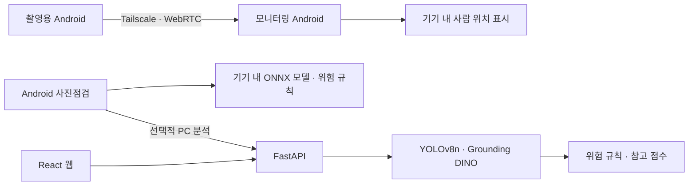

# 앗차차 (Atchacha)

**집 안 구석구석, 하루하루 안심하게.**

앗차차는 가정의 위험 후보를 사진으로 살펴보고, 남는 Android 휴대폰으로 집 안 영상을 확인하는 개인 시연용 생활안전 프로젝트입니다. 홈캠과 사진 안전점검을 앱의 시작 화면에서 선택할 수 있습니다.

> 사진으로 발견한 항목과 점수는 **참고 정보**입니다. 사진에 보이지 않는 위험이나 실제 통로·물기·고정 상태는 직접 확인해야 합니다. 낙상 자동 감지, 응급 호출과 긴급 출동은 제공하지 않습니다.

## 핵심 기능

| 기능 | 현재 동작 | 범위와 제한 |
| --- | --- | --- |
| 휴대폰 홈캠 | 촬영용 공기계와 모니터링용 휴대폰을 QR로 등록해 WebRTC 영상을 전송 | 두 기기에 Tailscale 필요. 촬영 앱과 화면을 켜 둔 상태에서 사용 |
| 사람 위치 표시 | 모니터링 휴대폰의 영상에서 최대 한 명을 찾아 이동에 맞춰 박스 표시 | 기기 내 처리. 신원 확인·낙상 판별이 아니며 누락 가능 |
| 사진 안전점검 | 사진과 대상·공간을 선택해 위험 후보, 위치, 참고 점수 및 권고 표시 | Android 기기 내 분석 또는 별도 PC 서버 분석 선택 |
| 가구·일반 물건 | YOLOv8n ONNX와 선택한 대상·공간의 규칙으로 확인 항목 제시 | 모바일은 모델 약 13MB를 별도 다운로드. 사진만으로 모서리의 날카로움이나 실제 통로 폭을 확정하지 않음 |
| 전기설비 후보 | 전선·콘센트·멀티탭·플러그 후보 표시, 작은 전선 확대 재검사 | 모바일은 실험 모델 약 204MB 별도 다운로드 및 점검 켜기 필요. 오탐·누락 가능, PC 결과와 동등성 미검증 |
| 웹 사진 점검 | FastAPI 서버에서 사진 분석 및 사진별 권고 제공 | PC 서버와 모델 필요. 웹의 추가 기능은 모바일 오프라인 기능과 범위가 다름 |

홈캠 연결은 촬영용 휴대폰과 모니터링용 휴대폰이 **각자의 네트워크**에 있어도 두 기기의 Tailscale이 연결되어 있으면 사용할 수 있습니다. Tailscale 없이 인터넷을 통한 연결은 구현하지 않았습니다. 영상 녹화·음성 전송·잠금 화면이나 백그라운드 촬영도 제공하지 않습니다.

## 모바일 사용 흐름

### 홈캠

1. 두 Android 휴대폰에 같은 앱과 Tailscale을 설치하고 같은 Tailnet에 연결합니다.
2. 촬영용 기기에서 **홈캠 → 촬영용 공기계**로 들어가 등록 QR을 만듭니다.
3. 모니터링 기기에서 **홈캠 → 모니터링 휴대폰**을 선택해 QR을 스캔합니다.
4. 촬영용 기기에서 촬영을 시작하고 모니터링 기기에서 영상을 엽니다. 촬영 화면에서 전면·후면 카메라를 전환할 수 있습니다.
5. 공기계를 충전 상태로 두고 앱과 화면을 켜 둡니다. 화면이 잠기거나 앱이 백그라운드로 가면 촬영이 중지됩니다.

QR은 한 번 등록한 뒤 재사용할 수 있는 기기 연결 정보를 발급합니다. 접근을 철회하려면 촬영 기기에서 등록된 모니터링 기기를 해제하고 다시 등록하세요. 사람 인식은 모니터링 기기에서 수신 프레임을 처리하며 사람 영상을 별도 분석 서버에 업로드하지 않습니다.

### 휴대폰 내 사진점검

1. 시작 화면에서 **사진 안전점검 → 휴대폰에서 분석**을 선택합니다.
2. 최초 한 번 가구 점검 모델을 내려받습니다. 전기설비 점검을 원하면 전기 위험 모델도 별도로 내려받아 **전기 점검 켜기**를 선택합니다.
3. 사진을 촬영하거나 선택하고 대상과 공간을 지정한 뒤 점검합니다.
4. 표시된 박스와 항목별 권고를 확인합니다. 사진에 충분한 근거가 없으면 점수 산정을 보류합니다.

모델은 앱 전용 저장 공간에 보관하며 화면에서 삭제할 수 있습니다. 모델을 받은 이후 휴대폰 내 점검에는 PC나 인터넷이 필요하지 않습니다. 선택한 사진을 분석 서버로 보내지 않습니다. 모델 다운로드에는 인터넷이 필요하며 최초 다운로드 크기는 가구 약 13MB, 전기 약 204MB입니다. 가중치는 APK에 포함하지 않지만 추론 런타임은 기본 앱에 포함됩니다.

전기 모델은 메모리 사용량이 큰 **시험 기능**입니다. 블랙베리 KEYone(Android 8.1, RAM 약 3.5GB)에서는 전기 모델 실행 중 앱 메모리 사용량이 약 2.5GB에 도달해 시험을 중단했습니다. 안전을 위해 총 RAM이 5GiB 미만인 기기에서는 해당 모델을 실행하지 않습니다. 이 제한은 지원 기기에서 속도나 정확도를 보장하지 않습니다. 전기 모델을 쓰지 않은 결과에는 전기설비가 점검되지 않았다고 표시합니다.

### PC 서버 사진점검

앱의 **PC 서버로 분석** 또는 웹 화면을 사용하면 기존 백엔드에서 YOLOv8n과 Grounding DINO를 실행합니다. PC가 켜져 있고 모델이 준비되어 있어야 합니다. 모바일의 PC 연결 모드는 코드 입력을 생략하도록 구성되어 있지만, 백엔드의 코드 없는 접근 예외는 **기본 비활성화**되어 있습니다. 필요한 개인 시연 환경에서만 `PHOTO_TAILNET_CODELESS=true`를 설정하고 PC 방화벽에서 신뢰하는 Tailscale 인터페이스·기기만 허용하세요. 이 예외는 개별 사용자 인증이 아닙니다. 모바일의 기기 내 사진 분석에는 이 설정이 필요하지 않습니다.

## 안전점수

사진에서 근거가 확인된 위험 후보를 기준으로 100점에서 고위험 25점, 중위험 12점, 저위험 5점을 차감합니다. 사진 기반 점수는 최대 80점이며 고위험이 1개 이상이면 최대 60점, 2개 이상이면 최대 40점입니다. 평가 가능한 위험 후보가 없으면 앱은 점수를 보류합니다. 점수는 검증된 사고 확률이나 안전 인증이 아닙니다.

전선 확대 재검사는 작은 후보를 더 잘 찾기 위한 시도이며 오탐과 처리 시간 증가가 있을 수 있습니다. 모바일 전기 모델은 PC의 약한 후보 재확인과 보조 분류 전체를 아직 포함하지 않습니다. 유사한 전기설비 후보가 겹치면 실제 종류를 확인하도록 표시합니다.

## 구성



- **Android:** React Native, Expo SDK 58, Expo Router, WebRTC, ONNX Runtime, Google ML Kit Pose Detection
- **웹:** React, Vite
- **PC 백엔드:** Python, FastAPI, SQLite, OpenCV, ONNX Runtime
- **기기 연결:** Tailscale, 단발 QR 등록, WebRTC 영상

상세 구현과 제약: [독립 실행 홈캠](docs/standalone-homecam.md), [웹 연동 홈캠](docs/live-homecam.md), [보안 운영](SECURITY.md).

## 로컬 개발

준비물: Python 3.12, Node.js 20.19 이상 또는 22.12 이상, Git. Android 네이티브 실행에는 Android SDK와 앱에 맞는 개발 빌드가 필요합니다. Expo Go에는 이 프로젝트의 WebRTC·ONNX 네이티브 모듈이 포함되지 않습니다.

### PC 웹·백엔드

```bash
git clone https://github.com/zlkdjkdj/26-2-AI-Project-.git
cd 26-2-AI-Project-
python -m venv backend/.venv
# 가상환경을 활성화한 뒤
pip install --require-hashes -r backend/requirements.lock
python scripts/setup_model.py
python scripts/setup_electrical_model.py
```

`backend/.env.example`을 `backend/.env`로 복사해 필요한 설정을 입력하세요. 기존 환경 파일을 덮어쓰지 마세요. API 키가 없으면 규칙 기반 안내를 사용하며, 실제 이미지 탐지에는 모델 파일이 필요합니다.

```bash
# 터미널 1
cd backend
uvicorn app.main:app --host 127.0.0.1 --port 8000

# 터미널 2
cd frontend
npm ci
npm run dev
```

웹 기본 주소는 `http://127.0.0.1:5173`, 백엔드는 `http://127.0.0.1:8000`입니다. 모바일의 PC 분석에 접근시키려면 백엔드를 PC의 Tailscale 주소에만 바인딩하고 신뢰 기기에 대해서만 방화벽 접근을 허용하세요. 공용 인터넷 포트 포워딩이나 Tailscale Funnel을 사용하지 마세요.

### Android

```bash
cd mobile
npm ci
npm test
npm run lint
npm run typecheck
```

네이티브 빌드에는 `react-native-webrtc` 패치가 필요하며 `npm ci`의 `postinstall`에서 적용합니다. 모델은 사용자가 앱에서 따로 다운로드하며 SHA-256을 검증합니다. 릴리스 시 코드 서명과 모델 라이선스 조건을 별도로 검토해야 합니다. 프로젝트에서 사용하는 YOLOv8n 가중치 메타데이터에는 **AGPL-3.0**이 명시되어 있습니다. 앱 배포·상용화 전에 해당 조건을 확인하세요.

## 개인정보와 보안

- 모바일 기기 내 사진 분석은 사진을 서버로 전송하지 않습니다. PC 분석을 선택하면 해당 사진이 PC 서버로 전송됩니다.
- 모델은 고정 해시를 검증한 뒤 기기의 앱 전용 저장 공간에 보관합니다. QR 등록 정보는 안전한 저장소에 보관합니다.
- 웹·PC API는 기본적으로 시연 코드 세션과 CSRF 검사로 보호합니다. 코드 없는 PC 사진 분석 옵션은 기본 꺼짐이며, 켜더라도 Tailscale IP만으로 개별 사용자가 인증되는 것은 아닙니다.
- API 키·DB·개인 사진·모델 파일·서명키·APK는 저장소에 올리지 않습니다. 홈캠은 개인 시연 구조이며 다중 사용자 권한 관리 서비스가 아닙니다.

상세한 운영 조건은 [SECURITY.md](SECURITY.md)를 확인하세요.

## 검증 현황과 남은 일

- 기존 두 휴대폰 간 Tailscale 홈캠은 사용자가 정상 동작을 확인했습니다. 사람 추적·전후면 전환·사진점검 개선도 사용자가 현재 버전의 정상 작동을 확인했습니다. 모든 조명·네트워크·기기 환경에서의 정확성을 보장하지는 않습니다.
- KEYone에서 인터넷을 끄고 가구 사진점검을 한 사례가 있습니다. S25에서는 전기 모델이 실행되었지만 멀티탭 사진을 다른 전기설비로 분류한 사례가 있어 개선과 추가 검증이 필요합니다.
- 전선·멀티탭·플러그의 **경량 전용 모델**, 다양한 사진의 오탐·미탐 측정, 전기 모델 메모리·속도 개선, 기본 앱 크기 축소가 남아 있습니다. 현재 기기 내 전기 모델을 경량 모델로 표현하지 않습니다.
- 사진 점검의 직접 점검·가상 배치 관련 기존 구현은 저장소에 남아 있으나, 현재 모바일 결과 화면의 핵심 흐름은 사진 피드백·권고·점수입니다.

참고 모델 및 자료: [ONNX Runtime 모바일](https://onnxruntime.ai/docs/tutorials/mobile/), [Ultralytics 라이선스](https://www.ultralytics.com/license), [참고 사진 출처](docs/interior-photo-credits.md).
