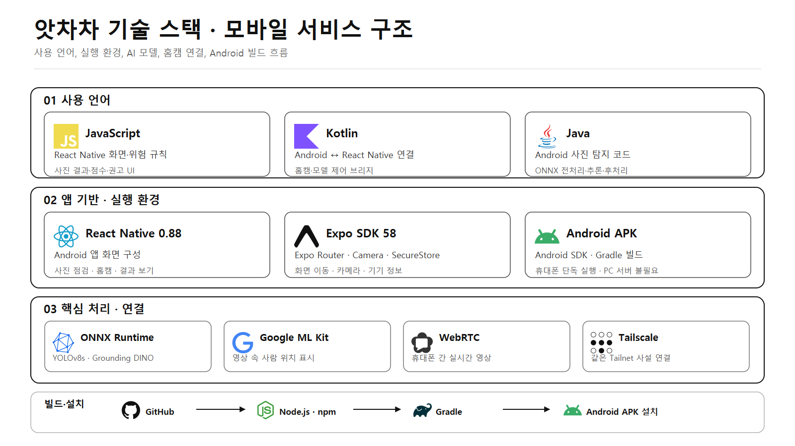
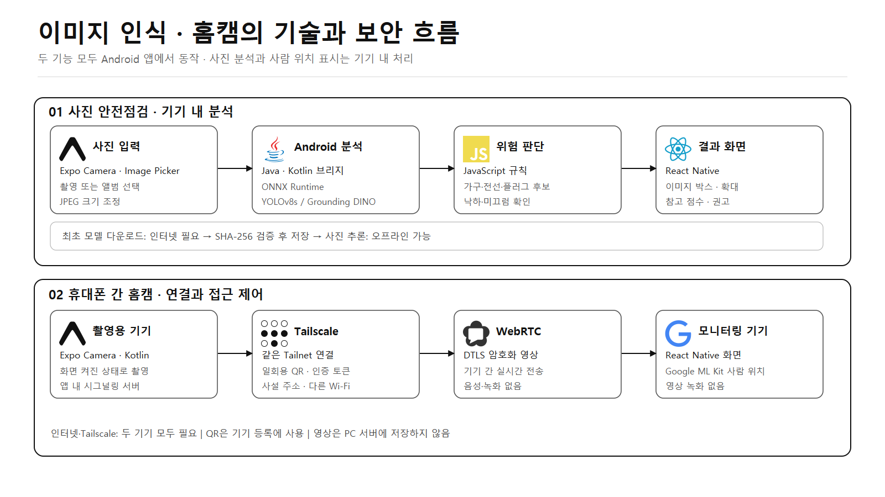

<div align="center">

# 앗차차

### 집 안 구석구석, 하루하루 안심하게.

**사진으로 살피는 생활 속 위험 후보와<br>남는 휴대폰으로 연결하는 우리 집 홈캠**

[서비스 소개](#앗차차가-하는-일) · [작동 원리](#어떻게-작동하나요) · [구성요소](#프로젝트-구성) · [기술 스택](#기술-스택) · [이용 방법](#이렇게-사용해요)

</div>


<div align="center"><sub>서비스 사용 장면을 표현한 콘셉트 이미지입니다.</sub></div>

## 우리 집을 더 세심하게

익숙한 공간에도 발에 걸릴 수 있는 전선과 부딪힐 수 있는 가구가 있습니다. 집을 비운 동안에는 가족과 공간의 안부가 궁금하기도 합니다.

**앗차차**는 사진으로 집 안의 위험 후보를 살펴보고, 사용하지 않는 휴대폰을 홈캠으로 활용하는 Android 생활안전 앱입니다.

## 앗차차가 하는 일

### 사진으로 살피는 우리 집 안전

사진 속 가구와 생활 물건을 찾아 확인할 항목을 표시하고, 참고 점수와 개선 권고를 제공합니다. 필요한 모델을 한 번 내려받으면 사진 분석은 휴대폰에서 실행됩니다.

- **사진 위에서 확인** — 탐지된 물건의 표시와 위치별 안내를 볼 수 있습니다.
- **종합 피드백** — 위험도별 항목과 먼저 확인할 권고를 한곳에 정리합니다.
- **확대와 개별 표시** — 사진을 확대하거나 항목을 선택해 원하는 박스만 살펴봅니다.
- **추가 위험 후보 점검** — 선택 모델을 내려받아 전선·멀티탭·플러그, 물기와 매트 후보 등을 함께 살펴봅니다.

### 남는 휴대폰으로 만드는 우리 집 홈캠

촬영용 휴대폰과 모니터링용 휴대폰을 QR로 등록하면, 같은 Tailscale 네트워크에 연결된 두 기기 사이에서 실시간 영상을 확인할 수 있습니다. 두 기기는 서로 다른 Wi-Fi나 모바일 데이터를 사용할 수 있습니다.

- **PC 없이 연결** — 휴대폰 두 대로 촬영과 모니터링을 진행합니다.
- **화면 조작** — 영상 확대, 회전, PIP와 촬영 카메라 전환을 제공합니다.
- **사람 위치 표시** — 모니터링 화면에서 최대 한 명의 위치를 표시합니다.
- **영상 녹화** — 모니터링 기기에서 짧은 무음 영상을 저장하고 앱에서 확인합니다. Android 10 이상에서는 갤러리에도 복사하도록 구현했습니다.
- **낙상 의심 기록** — 촬영 기기에서 직접 켜는 실험 기능으로, 자세 변화가 감지되면 전후 영상을 저장하도록 구현했습니다.

PIP, 갤러리 저장과 낙상 의심 기록은 기기별 실사용 검수가 진행 중입니다. 낙상 의심 기능은 오탐·누락 가능성이 있으며 긴급 알림이나 자동 신고를 제공하지 않습니다.

## 이런 분께 도움이 돼요

| 상황 | 앗차차 활용 |
| --- | --- |
| **가족이 지내는 공간을 살펴볼 때** | 사진 속 가구와 전기설비 주변에서 확인할 항목을 정리합니다. |
| **익숙한 집을 다시 점검할 때** | 이동 통로와 가구 주변을 사진으로 살펴봅니다. |
| **집을 비운 동안 공간이 궁금할 때** | 남는 휴대폰을 활용해 원격으로 실시간 영상을 확인합니다. |

## 이렇게 사용해요

### 사진 안전점검

1. 시작 화면에서 **사진 안전점검**을 선택합니다.
2. 가구 점검 모델을 내려받고, 필요하면 추가 위험 모델도 설치합니다.
3. 가구·바닥·이동 통로가 함께 보이도록 촬영하거나 사진을 선택합니다.
4. 종합 피드백과 참고 점수를 확인하고, 항목별 표시와 권고를 살펴봅니다.

### 홈캠

1. 두 Android 휴대폰에 앱과 Tailscale을 설치하고 같은 Tailnet에 연결합니다.
2. 집에 둘 휴대폰에서 **촬영용 공기계**를 선택하고 QR을 만듭니다.
3. 모니터링 휴대폰에서 QR을 스캔해 등록합니다.
4. 촬영용 기기에서 촬영을 시작하고 모니터링 기기에서 영상을 엽니다.

촬영용 기기는 충전하면서 앱과 화면을 켜 두세요. 사진 점검 모델은 최초 다운로드 시 인터넷이 필요합니다. 자세한 설명은 [홈캠 안내](docs/standalone-homecam.md)를 확인해 주세요.

## 어떻게 작동하나요



### 사진 안전점검

```text
사진 촬영·선택 → 이미지 크기 조정 → 휴대폰 내 객체 탐지
             → 위험 후보별 규칙 적용 → 참고 점수·종합 피드백·항목별 권고
```

1. **사진 입력** — 카메라로 촬영하거나 앨범에서 선택합니다. 가구, 바닥과 이동 통로가 함께 보이도록 촬영하면 결과를 해석하기 쉽습니다.
2. **모델 준비** — 처음 사용할 때 가구 점검용 YOLOv8s 모델 약 45MB를 내려받습니다. 전기설비·바닥 후보 점검에는 약 204MB의 Grounding DINO 모델이 추가로 필요합니다. 앱은 다운로드한 모델의 SHA-256을 확인한 뒤 기기에 저장합니다.
3. **기기 내 추론** — Android의 ONNX Runtime이 사진에서 가구와 일반 물건을 찾고, 추가 모델을 켠 경우 전선·멀티탭·플러그와 바닥 등의 후보를 찾습니다. 모델 설치 후 추론은 인터넷과 PC 없이 실행됩니다.
4. **위험 후보 정리** — 탐지된 물건 종류와 사진 안의 위치를 로컬 규칙에 대입해 확인할 항목과 권고를 만듭니다. 가구는 단단하고 노출된 모서리가 있는지 직접 확인하도록 안내합니다. 물기·매트와 높은 곳으로 보이는 물건도 실제 상태를 확인하는 후보로 제공합니다.
5. **점수와 결과 표시** — 확인 항목의 위험도에 따라 참고 점수를 계산하고, 높은 위험도부터 종합 피드백을 정리합니다. 사용자는 번호를 눌러 해당 박스만 표시하거나 사진을 확대해 볼 수 있습니다.

현재 점수는 위험 후보별로 고위험 25점, 중위험 12점, 저위험 5점을 차감하는 규칙 기반 참고값입니다. 고위험 항목 수에 따른 상한도 적용하며, 평가할 항목이 없으면 점수 산정을 보류합니다. **점수는 사고 확률이나 안전 인증이 아닙니다.** 모서리의 날카로움, 바닥 마찰, 물기, 물건의 실제 높이나 전기설비 손상을 사진만으로 확정하지 않습니다.

### 휴대폰 간 홈캠



```text
촬영용 휴대폰 ── 일회용 QR 등록 ── 모니터링 휴대폰
       │                                  │
       └──── Tailscale 연결 + WebRTC 영상 ────┘
```

1. 두 기기를 같은 Tailscale 계정의 Tailnet에 연결합니다. 물리적으로 같은 장소나 동일 Wi-Fi일 필요는 없지만, 두 기기 모두 인터넷과 Tailscale 연결은 필요합니다.
2. 촬영 기기가 유효 시간이 있는 일회용 QR을 만들고, 모니터링 기기가 이를 읽어 등록합니다. 등록된 기기 정보는 휴대폰의 보안 저장소에 보관합니다.
3. 촬영 기기 내부의 통신 모듈이 Tailscale 경로를 통해 기기 간 연결 정보를 교환하고, WebRTC 연결을 설정합니다. 별도의 PC 서버는 필요하지 않으며, 이 연결 정보 교환 모듈이 영상을 중계하거나 저장하지는 않습니다.
4. 영상은 WebRTC로 전송하고, 모니터링 기기에서는 Google ML Kit 자세 인식을 이용해 최대 한 명의 위치를 화면에 표시합니다. 사람 위치 표시는 신원 확인 기능이 아닙니다.
5. 모니터링 화면에서는 확대·회전·PIP와 수동 녹화를 사용할 수 있도록 구현했습니다. 수동 녹화는 모니터링 폰에 저장되며 Android 10 이상에서는 갤러리에도 복사합니다.

### 낙상 의심 영상 기록

촬영 기기에서 사용자가 기능을 켜면 ML Kit의 어깨·엉덩이 위치와 시간에 따른 자세 변화를 확인합니다. 설정된 조건에 해당하면 영상 프레임을 바탕으로 전후 약 8초씩 저장을 시도합니다. 기록은 촬영 기기 안에 남습니다.

이 기능은 **실험적인 자세 변화 규칙**이며 검증된 낙상 판별 모델이 아닙니다. 사람의 자세나 카메라 각도에 따라 오탐·누락이 발생할 수 있고, 화면이 꺼지거나 앱이 백그라운드에 들어가면 촬영이 중지됩니다. 자동 신고나 긴급 출동은 제공하지 않습니다.

## 프로젝트 구성

| 구성요소 | 역할 | 주요 위치 |
| --- | --- | --- |
| **앱 화면과 이동** | 시작 가이드, 홈캠 역할 선택, 사진 점검과 결과 화면 | `mobile/src/app/`, `mobile/src/WelcomeGuide.js`, `mobile/src/PhotoScan.js` |
| **사진 분석 및 피드백** | 모델 추론 호출, 위험 후보 규칙, 참고 점수와 종합 안내 | `mobile/src/offlineSafety.js`, `mobile/src/offlineRules.js`, `mobile/src/scanFeedback.js` |
| **Android 사진 탐지** | YOLOv8s·Grounding DINO 전처리, ONNX 추론과 후처리 | `mobile/modules/homecam-bridge/android/src/main/java/com/atchacha/homecam/bridge/` |
| **홈캠 연결** | QR 등록, Tailscale 경로 검사, WebRTC 영상 연결 | `mobile/src/directProtocol.js`, `mobile/src/DirectVideo.js`, `HomecamServer.kt` |
| **사람 위치·영상 기록** | ML Kit 자세 기반 위치 표시, 실험적 낙상 의심 기록, 수동 녹화 및 갤러리 복사 | `PersonVideoDetector.java`, `FallEventRecorder.java`, `GalleryExport.java` |
| **공통 네이티브 연결** | React Native 화면과 Android 기능 사이의 브리지 | `mobile/modules/homecam-bridge/` |
| **문서 및 검증** | 연결·보안·개발 안내, 단위 테스트와 공개 파일 검사 | `docs/`, `mobile/tests/`, `scripts/check_publication.py` |

## 소중한 공간을 위한 선택

사진 점검은 휴대폰에서 수행하며 사진을 외부 분석 서버에 보내지 않습니다. 홈캠은 Tailscale 연결과 일회용 QR 등록을 사용하고, 영상은 WebRTC로 전송합니다. 녹화는 기기 내 저장 방식이며, Android 10 이상에서 수동 녹화본을 갤러리에 복사할 수 있습니다. [보안 안내](SECURITY.md)에서 자세한 내용을 확인하세요.

## 기술 스택

| 분야 | 기술 | 프로젝트에서 하는 일 |
| --- | --- | --- |
| **사용 언어** | JavaScript | 앱 화면, 홈캠 연결 흐름, 사진 위험 규칙과 피드백 |
| **Android 네이티브** | Kotlin · Java | 기기 간 통신, 모델 추론, 영상 처리와 Android 기능 연결 |
| **모바일 앱** | React Native 0.88 · React 19 | Android 앱 화면 및 사용자 상호작용 |
| **앱 기반** | Expo SDK 58 · Expo Router | 앱 구성, 화면 이동 및 네이티브 기능 연동 |
| **카메라·기기 기능** | Expo Camera · Image Picker · SecureStore | 촬영·사진 선택, QR 스캔과 등록 정보 보관 |
| **사진 객체 탐지** | YOLOv8s · Grounding DINO | 가구·일반 물건 및 전기설비·바닥 위험 후보 탐지 |
| **기기 내 AI 추론** | ONNX Runtime Android 1.22.0 | 내려받은 모델을 휴대폰에서 실행 |
| **사람 자세 인식** | Google ML Kit Pose Detection | 영상 속 사람 위치 표시 및 실험적 자세 변화 감지 |
| **실시간 영상** | react-native-webrtc · WebRTC | 휴대폰 사이의 실시간 영상 연결 |
| **기기 연결** | Tailscale · QR 코드 | Tailnet 접근 경로와 일회용 기기 등록 |
| **Android 영상 저장** | MediaCodec · MediaMuxer · MediaStore | 무음 녹화본 생성, 앱 내부 저장 및 갤러리 복사 |
| **개발·빌드** | Node.js · npm · Android SDK · Gradle | 의존성 설치, 검사 및 Android 앱 빌드 |
| **형상 관리** | Git · GitHub | 소스 코드 및 개발 이력 관리 |

### 개발 환경

Node.js 20.19 이상 또는 22.12 이상과 Android SDK, Java가 필요합니다. WebRTC와 ONNX 네이티브 모듈을 사용하므로 Expo Go 대신 자체 Android 개발 빌드 또는 릴리스 빌드를 사용합니다.

```bash
cd mobile
npm ci
npm test
npm run lint
npm run typecheck
```

설치 시 `postinstall`이 프로젝트의 WebRTC 패치를 적용합니다. 자세한 빌드 조건은 [개발 안내](docs/development.md)를 참고해 주세요. 모델 가중치는 저장소에 포함되지 않으며, 사용 시 별도 다운로드합니다. YOLOv8s 가중치에는 AGPL-3.0 라이선스가 명시되어 있어 배포 전 모델과 라이브러리의 조건을 확인해야 합니다.

## 알아두세요

- 사진의 표시와 점수는 현장 확인을 돕는 참고 정보입니다. 탐지되지 않은 위험이 있을 수 있으며, 사진만으로 사고 위험을 확정할 수 없습니다.
- 전선·멀티탭·플러그와 바닥 위험 후보 탐지는 별도 모델을 사용하는 시험 기능으로, 오탐과 누락이 가능합니다.
- 수동 녹화는 최대 60초, 무음, 초당 약 5장 및 긴 변 320px의 저해상도 방식입니다. 저장·재생과 PIP는 기기별 검수가 필요합니다.
- 낙상 의심 영상 기록은 실험 기능입니다. 낙상을 확정하지 못하고 위험 상황을 놓칠 수 있으므로 응급 감시나 신고 수단으로 의존할 수 없습니다.
- 촬영용 기기의 앱이 백그라운드로 이동하거나 화면이 잠기면 촬영이 중지됩니다.

<div align="center">

**앗차차**<br>
사진 한 장의 확인과 작은 화면 하나로, 더 세심한 일상을.

</div>
