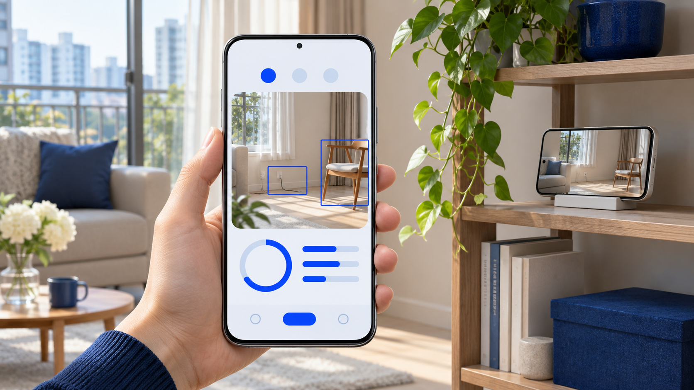

# 앗차차

### 집 안 구석구석, 하루하루 안심하게.

**사진으로 살피는 생활 속 위험 후보와 남는 휴대폰으로 연결하는 우리 집 홈캠**

[서비스 소개](#앗차차가-하는-일) · [이용 방법](#이렇게-사용해요) · [기술 스택](#기술-스택)

서비스 사용 장면을 표현한 콘셉트 이미지입니다.

## 우리 집을 더 세심하게

익숙한 공간에도 발에 걸릴 수 있는 전선과 부딪힐 수 있는 가구가 있습니다. 집을 비운 동안에는 가족과 공간의 안부가 궁금하기도 합니다.

**앗차차**는 사진으로 집 안의 위험 후보를 살펴보고, 사용하지 않는 휴대폰을 홈캠으로 활용하는 Android 생활안전 앱입니다.

## 앗차차가 하는 일

### 사진으로 살피는 우리 집 안전

사진 속 가구와 생활 물건을 찾아 확인할 항목을 표시하고, 참고 점수와 개선 권고를 제공합니다. 필요한 모델을 한 번 내려받으면 사진 분석은 휴대폰에서 실행됩니다.

- **사진 위에서 확인** — 탐지된 물건의 표시와 위치별 안내를 볼 수 있습니다.
- **종합 피드백** — 위험도별 항목과 먼저 확인할 권고를 한곳에 정리합니다.
- **확대와 개별 표시** — 사진을 확대하거나 항목을 선택해 원하는 박스만 살펴봅니다.
- **추가 위험 후보 점검** — 선택 모델을 내려받아 전선·멀티탭·플러그, 물기와 매트 후보 등을 함께 살펴봅니다.

### 남는 휴대폰으로 만드는 우리 집 홈캠

촬영용 휴대폰과 모니터링용 휴대폰을 QR로 등록하면, 같은 Tailscale 네트워크에 연결된 두 기기 사이에서 실시간 영상을 확인할 수 있습니다. 두 기기는 서로 다른 Wi-Fi나 모바일 데이터를 사용할 수 있습니다.

- **PC 없이 연결** — 휴대폰 두 대로 촬영과 모니터링을 진행합니다.
- **화면 조작** — 영상 확대, 회전, PIP와 촬영 카메라 전환을 제공합니다.
- **사람 위치 표시** — 모니터링 화면에서 최대 한 명의 위치를 표시합니다.
- **영상 녹화** — 모니터링 기기에서 짧은 무음 영상을 저장하고 앱에서 확인합니다. Android 10 이상에서는 갤러리에도 복사하도록 구현했습니다.
- **낙상 의심 기록** — 촬영 기기에서 직접 켜는 실험 기능으로, 자세 변화가 감지되면 전후 영상을 저장하도록 구현했습니다.

PIP, 갤러리 저장과 낙상 의심 기록은 기기별 실사용 검수가 진행 중입니다. 낙상 의심 기능은 오탐·누락 가능성이 있으며 긴급 알림이나 자동 신고를 제공하지 않습니다.

## 이런 분께 도움이 돼요

| 상황 | 앗차차 활용 |
| --- | --- |
| **가족이 지내는 공간을 살펴볼 때** | 사진 속 가구와 전기설비 주변에서 확인할 항목을 정리합니다. |
| **익숙한 집을 다시 점검할 때** | 이동 통로와 가구 주변을 사진으로 살펴봅니다. |
| **집을 비운 동안 공간이 궁금할 때** | 남는 휴대폰을 활용해 원격으로 실시간 영상을 확인합니다. |

## 이렇게 사용해요

### 사진 안전점검

1. 시작 화면에서 **사진 안전점검**을 선택합니다.
2. 가구 점검 모델을 내려받고, 필요하면 추가 위험 모델도 설치합니다.
3. 가구·바닥·이동 통로가 함께 보이도록 촬영하거나 사진을 선택합니다.
4. 종합 피드백과 참고 점수를 확인하고, 항목별 표시와 권고를 살펴봅니다.

### 홈캠

1. 두 Android 휴대폰에 앱과 Tailscale을 설치하고 같은 Tailnet에 연결합니다.
2. 집에 둘 휴대폰에서 **촬영용 공기계**를 선택하고 QR을 만듭니다.
3. 모니터링 휴대폰에서 QR을 스캔해 등록합니다.
4. 촬영용 기기에서 촬영을 시작하고 모니터링 기기에서 영상을 엽니다.

촬영용 기기는 충전하면서 앱과 화면을 켜 두세요. 사진 점검 모델은 최초 다운로드 시 인터넷이 필요합니다. 자세한 설명은 [홈캠 안내](docs/standalone-homecam.md)를 확인해 주세요.

## 소중한 공간을 위한 선택

사진 점검은 휴대폰에서 수행하며 사진을 외부 분석 서버에 보내지 않습니다. 홈캠은 Tailscale 연결과 일회용 QR 등록을 사용하고, 영상은 WebRTC로 전송합니다. 녹화는 기기 내 저장 방식이며, Android 10 이상에서 수동 녹화본을 갤러리에 복사할 수 있습니다. [보안 안내](SECURITY.md)에서 자세한 내용을 확인하세요.

## 기술 스택

| 분야 | 사용 기술 |
| --- | --- |
| **사용 언어** | JavaScript · Kotlin · Java |
| **모바일 앱** | React Native · Expo · Android |
| **홈캠** | WebRTC · Tailscale · Google ML Kit |
| **사진 분석** | YOLOv8s · Grounding DINO · ONNX Runtime |
| **개발·빌드** | Node.js · npm · Android SDK · Gradle |

개발 환경과 실행 방법은 [개발 안내](docs/development.md)를 참고해 주세요.

## 알아두세요

- 사진의 표시와 점수는 현장 확인을 돕는 참고 정보입니다. 탐지되지 않은 위험이 있을 수 있으며, 사진만으로 사고 위험을 확정할 수 없습니다.
- 전선·멀티탭·플러그와 바닥 위험 후보 탐지는 별도 모델을 사용하는 시험 기능으로, 오탐과 누락이 가능합니다.
- 수동 녹화는 최대 60초, 무음, 초당 약 5장 및 긴 변 320px의 저해상도 방식입니다. 저장·재생과 PIP는 기기별 검수가 필요합니다.
- 낙상 의심 영상 기록은 실험 기능입니다. 낙상을 확정하지 못하고 위험 상황을 놓칠 수 있으므로 응급 감시나 신고 수단으로 의존할 수 없습니다.
- 촬영용 기기의 앱이 백그라운드로 이동하거나 화면이 잠기면 촬영이 중지됩니다.

**앗차차** 
사진 한 장의 확인과 작은 화면 하나로, 더 세심한 일상을.

